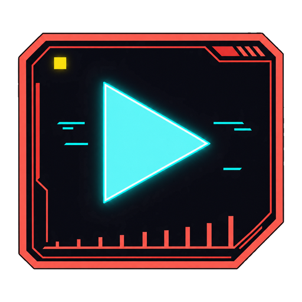
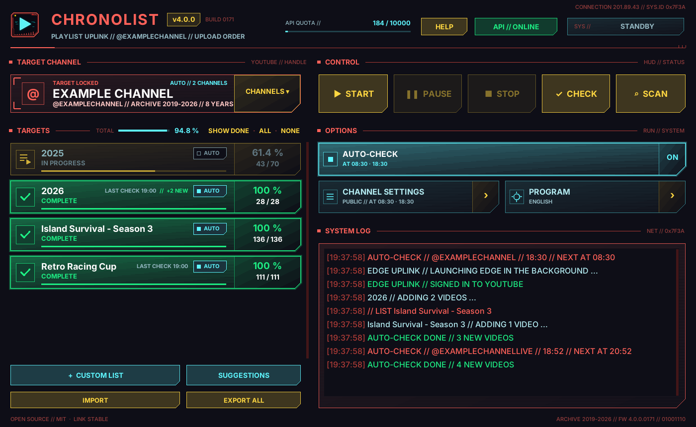
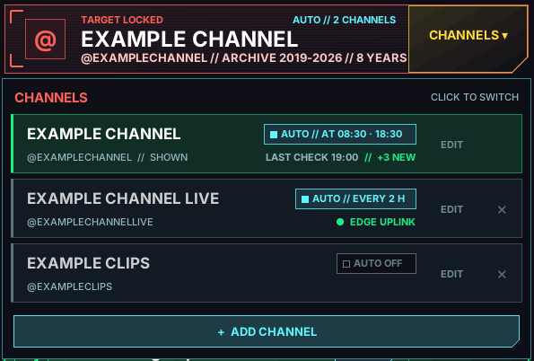
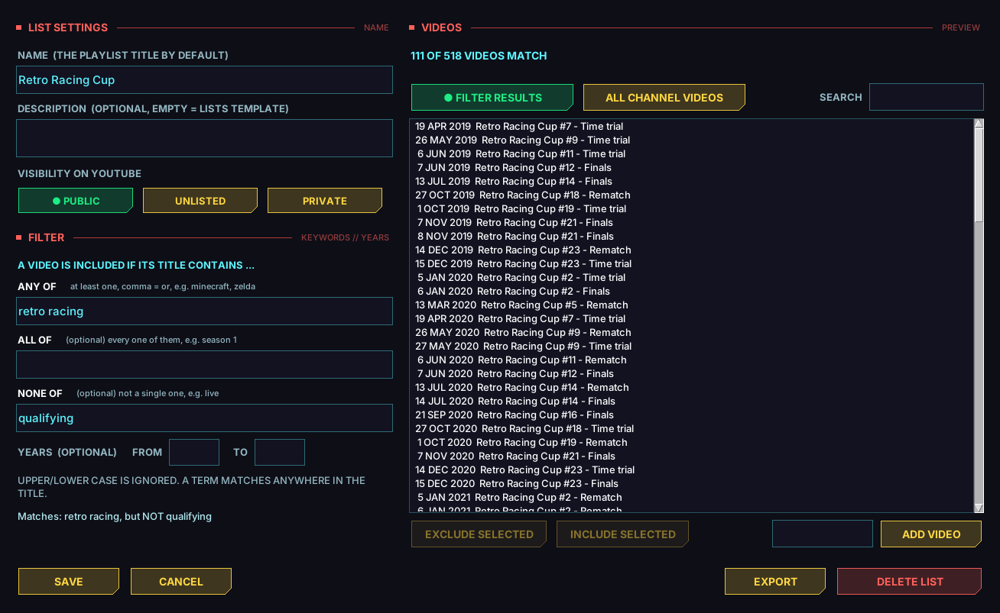
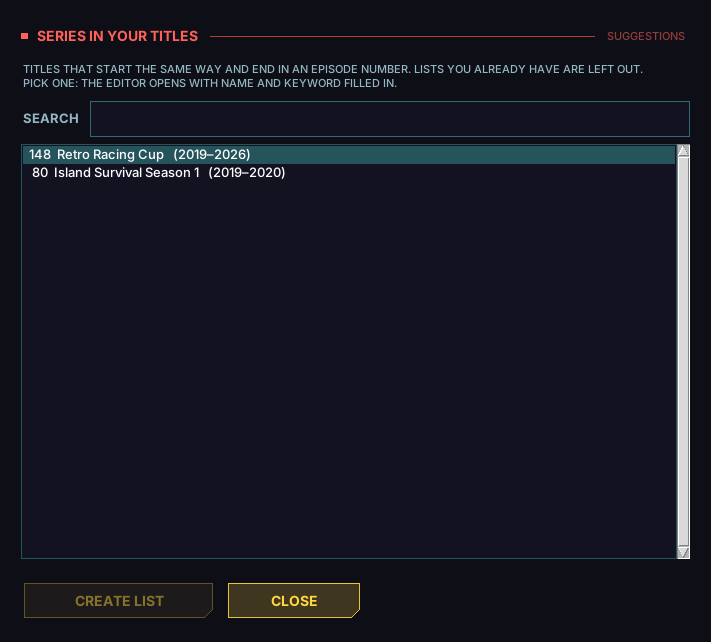

<p align="center">
  
</p>

<h1 align="center">Chronolist</h1>

<p align="center">
  Builds chronological YouTube playlists of a channel's videos in upload order: one per year, plus your own keyword lists such as a series. Keeps them up to date in the background, for as many channels as you like.
</p>

<p align="center">
  <a href="https://github.com/LooneyN/chronolist/releases/latest"></a>
  <a href="LICENSE"></a>
  
  
</p>

---

<p align="center">
  
</p>

YouTube only lets you sort a channel's uploads by "latest" or "popular". Chronolist fixes that: for any channel you choose, it creates playlists like **"ChannelName 2012 in upload order"** (the title is configurable) and fills them with all videos from that year, oldest first. On top of that you can build your own lists, for example one per series or season, from keywords in the video titles. Perfect for watching a long-running channel from the very beginning, and with AUTO-CHECK your playlists stay up to date by themselves, for as many channels as you like.

## Features

**Playlists**

- **Any channel**: enter a `@handle`, channel URL or channel ID; name and start year are detected automatically.
- **One playlist per year**, filled in exact upload order, with progress saved per channel and year.
- **Custom lists**: collect videos by title keywords (contains any / all / none of them, optionally limited to a range of years) into a playlist with your own name, description and visibility, always in upload order. A list can also mix in videos from other channels in your channel list, such as a live channel, in exact upload order. The editor shows the matches live, lets you exclude or add single videos and start from a copy of an existing list.
- **Suggestions**: finds series in your video titles (e.g. "Season 04 #12") and prepares a list for each one.
- **Videos only**: shorts are left out, livestreams stay in.
- **More than 5,000 videos per year**: split automatically into "Part 1", "Part 2", … because a YouTube playlist holds at most 5,000 videos.

**Several channels**

- **Channel list**: keep all your channels in one place and switch with one click, even while a run is active. The channel that is being worked on blinks in the list.
- **AUTO-CHECK in the background**: every channel with AUTO-CHECK on is checked on its own schedule (an interval or up to four fixed times a day), even while another channel is shown. New videos are appended to the current year and to all matching custom lists.
- **New video alert**: the taskbar flashes and Windows shows a notification naming the channel.

**Quota and reliability**

- **API for reading, Edge for writing**: finding videos and checking playlists uses the official API and costs almost no quota; creating playlists and adding videos happens invisibly in Edge (see the warning below).
- **Archive scan**: reads the whole upload list once and prepares all years at very low quota cost; older years beyond YouTube's 20,000-upload cap are found completely via the channel's videos page sorted by oldest.
- **Quota-aware**: shows today's API usage in the header, remembers when the limit is reached and when it resets (in your local time).
- **Self-checking**: remembers the batch in flight and checks only that one after an interruption; a full duplicate check runs at the end of each year and with CHECK. A playlist that was deleted on YouTube is created and filled again.
- **Pause, resume, stop**; if a year can't be searched right now, Chronolist continues with the next ready one. **HIDE DONE** collapses finished cards to keep the list short.

**Comfort**

- **Auto-run** on launch, **start with Windows** and **start minimized** (in the program settings).
- **English or German** interface, adjustable text size, in-app **HELP** for every button and status.
- **Updates in the app**: a green UPDATE button in the header tells you when a new release is available; one click downloads it, replaces the exe and restarts. Your settings and progress stay.

<p align="center">
  
</p>

<p align="center">
  
  &nbsp;
  
</p>

## Download

Grab `Chronolist-vX.Y.Z-windows.zip` from the [latest release](https://github.com/LooneyN/chronolist/releases/latest), unzip it into its own folder and start `Chronolist.exe`.

All settings and progress are stored in that folder, so keep it in a place where you have write access (not `C:\Program Files`).

> Windows SmartScreen may warn about an unknown publisher because the exe is not code-signed. Choose **More info → Run anyway**, or run from source instead.

## Set up your own Google API access

Chronolist uses the official YouTube Data API v3 with **your own** credentials. Nothing is shared with the author. Usage is free; Google just limits how much you can do per day.

1. Open the [Google Cloud Console](https://console.cloud.google.com/) and create a new project.
2. Under **APIs & Services → Library**, enable **YouTube Data API v3**.
3. Under **APIs & Services → OAuth consent screen**, set it up as **External** and add your own Google account as a **test user**.
4. Under **APIs & Services → Credentials**, choose **Create credentials → OAuth client ID** with the application type **TVs and Limited Input devices**.
5. Copy the **Client ID** and **Client secret** into Chronolist via the **API** button in the header.
6. On the first START, Chronolist shows a link and a code. Open the link, enter the code and sign in with the YouTube account that should own the playlists.

## Usage

1. Click **CHANNELS ▾** on the *Target Channel* card, then **+ ADD CHANNEL**, and enter the channel.
2. On the first start, Chronolist explains how it works with YouTube. Sign in to YouTube once via **YOUTUBE SIGN-IN** (also under **PROGRAM**).
3. All completed years are selected. Deselect the ones you don't want and drag the cards to change the order; selected cards are processed from top to bottom.
4. Optional: **+ CUSTOM LIST** creates a list of your own, **SUGGESTIONS** finds series in your titles, **HIDE DONE** collapses finished cards.
5. Press **START**.
6. Optional: switch on **AUTO-CHECK** and set its schedule under **CHANNEL SETTINGS**. The current year and all lists are then kept up to date by themselves. Repeat for other channels; each one keeps its own schedule.

The in-app **HELP** (English or German, following the program language) explains every button, status and pause in detail.

### Daily limits

| Action | Cost |
| --- | --- |
| Archive scan (upload list) | 1 unit per 50 videos |
| Date search for old years | 100 units per 50 videos, plus ~100 searches per day limit |
| Check a playlist | 1 unit per 50 videos |
| Create a playlist, add or remove a video | no units (through Edge) |

The default quota is 10,000 units per day. It resets at midnight Pacific Time. If it is used up, Chronolist reads the channel page in Edge instead.

### Edge ⚠️

Everything that changes a playlist (creating playlists, adding, removing and sorting videos) happens in Microsoft Edge with its own profile in which you are signed in to YouTube, using the same requests the website itself sends when you save a video to a playlist. It works in batches with deliberate pauses. Edge runs invisibly in the background; a window only opens when you need to sign in. Sign in once via **PROGRAM > YOUTUBE SIGN-IN**; the sign-in is kept.

**This is automated use of the YouTube website and is not allowed by YouTube's Terms of Service. In the worst case your account can be restricted. Use it at your own risk.** Chronolist shows this notice once on the first start.

If you prefer the official API for everything, switch on **PROGRAM > USE API FOR EVERYTHING**. Creating a playlist, adding or removing a video then costs 50 units each, so the daily quota is enough for about 200 videos. Chronolist keeps 1,000 units for AUTO-CHECK and continues in Edge after that.

## Configuration

Under **PROGRAM** in the app you can set:

- The **language**: English or German (interface, tooltips, help and log)
- The **text size** of the whole interface: 90, 95, 100, 105 or 110 % (default 100 %)
- The **new video alert**, **auto-run**, **start on boot** and **start minimized**
- **YOUTUBE SIGN-IN** and **USE API FOR EVERYTHING**
- The **update check** on launch

Under **CHANNEL SETTINGS** you can set, per channel:

- The **AUTO-CHECK schedule**: an interval (15 minutes to 24 hours) or up to four fixed times a day
- **Title** and optional **description** of new playlists, with placeholders `{channel}`, `{handle}`, `{year}` and `{count}` (number of videos in that year) and a live preview, separately for years and custom lists
- **Visibility**: public, unlisted or private (custom lists can override it in the list editor)

A new channel starts with the settings of the channel that was active before. Playlist title changes apply to playlists created from then on.

## Your data

Everything stays in the program folder and is never uploaded anywhere except to Google/YouTube itself:

| File / folder | Content |
| --- | --- |
| `credentials.json` | Your Client ID and secret |
| `token.json` | Your Google sign-in |
| `settings.json` | Program settings and selected channel |
| `quota.json` | Remembered daily limit |
| `data/channels.json` | Your channel list |
| `data/<channel>/` | Video lists, titles, custom lists, progress and the channel's settings |
| `browser_profile/` | YouTube sign-in of Chronolist's Edge profile |

Never share these files. They are excluded in `.gitignore`.

## Run from source

Requires Windows and Python 3.10 or newer.

```bash
git clone https://github.com/LooneyN/chronolist.git
cd chronolist
pip install -r requirements.txt
pythonw chronolist.py
```

Chronolist uses Microsoft Edge, which comes with Windows; no extra browser download is needed.

Build the exe yourself:

```bash
pip install pyinstaller
pyinstaller --onefile --windowed --name Chronolist --icon assets/chronolist.ico chronolist.py
```

## Releases

Releases are built automatically by GitHub Actions. Day-to-day work happens on the `dev` branch; `main` only receives finished releases. To publish a new version:

1. Merge `dev` into `main`.
2. Set `VERSION` in `chronolist.py` to the final number (no `-dev` suffix) and move the `[Unreleased]` entries in `CHANGELOG.md` to a new version section.
3. Push `main`, then either push the tag (`git tag vX.Y.Z` and `git push origin vX.Y.Z`) or start **Actions → Release → Run workflow** on `main`, which creates the tag itself.

The workflow checks that the tag matches `VERSION`, builds `Chronolist.exe` and publishes the release with the changelog entry as notes.

## About

Chronolist was written entirely with [Claude](https://claude.ai), an AI by Anthropic.

It is an independent project and is not affiliated with, endorsed by or sponsored by YouTube or Google. You use your own API credentials and your own account and are responsible for complying with YouTube's Terms of Service.

Bug reports and ideas are welcome as [issues](https://github.com/LooneyN/chronolist/issues).

## License

[MIT](LICENSE)
