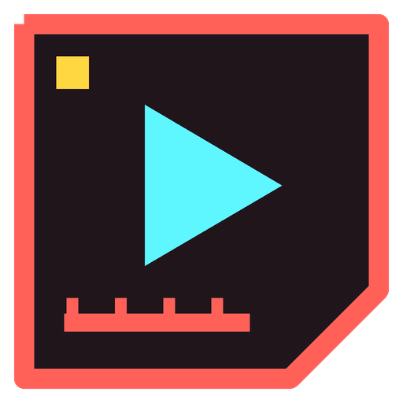

<p align="center">
  
</p>

<h1 align="center">Chronolist</h1>

<p align="center">
  Builds one public YouTube playlist per year with every video of a channel, in upload order.
</p>

<p align="center">
  <a href="https://github.com/LooneyN/chronolist/releases/latest"></a>
  <a href="LICENSE"></a>
  
  
</p>

---

YouTube only lets you sort a channel's uploads by "latest" or "popular". Chronolist fixes that: for any channel you choose, it creates playlists like **"ChannelName 2012 in Upload-Reihenfolge"** and fills them with all videos from that year, oldest first. Perfect for watching a long-running channel from the very beginning.

## Features

- **Any channel**: enter a `@handle`, channel URL or channel ID; name and start year are detected automatically.
- **One playlist per year**, filled in exact upload order, with progress saved per channel and year.
- **Quota-aware**: knows YouTube's daily API limits, remembers when they are used up and shows when they reset (in your local time).
- **Archive scan**: reads the whole upload list once and prepares all years at very low quota cost; older years beyond YouTube's 20,000-upload cap are found via a month-by-month date search.
- **Self-checking**: removes duplicate videos and re-syncs progress at start, every 750 videos, after STOP and at the end of each year.
- **Pause, resume, stop, batch limit, skip ahead** to the next ready year.
- **Auto-run** on launch and optional **start with Windows**.
- **Optional browser fallback** (off by default, see the warning below).
- **Updates in the app**: a green tag in the header tells you when a new release is available; one click downloads it, replaces the exe and restarts. Your settings and progress stay.

## Download

Grab `Chronolist-vX.Y.Z-windows.zip` from the [latest release](https://github.com/LooneyN/chronolist/releases/latest), unzip it into its own folder and start `Chronolist.exe`.

All settings and progress are stored in that folder, so keep it in a place where you have write access (not `C:\Program Files`).

> Windows SmartScreen may warn about an unknown publisher because the exe is not code-signed. Choose **More info → Run anyway**, or run from source instead.

## Set up your own Google API access

Chronolist uses the official YouTube Data API v3 with **your own** credentials. Nothing is shared with the author. Usage is free; Google just limits how much you can do per day.

1. Open the [Google Cloud Console](https://console.cloud.google.com/) and create a new project.
2. Under **APIs & Services → Library**, enable **YouTube Data API v3**.
3. Under **APIs & Services → OAuth consent screen**, set it up as **External** and add your own Google account as a **test user**.
4. Under **APIs & Services → Credentials**, choose **Create credentials → OAuth client ID** with the application type **TVs and Limited Input devices**.
5. Copy the **Client ID** and **Client secret** into Chronolist via the **API** button in the header.
6. On the first START, Chronolist shows a link and a code. Open the link, enter the code and sign in with the YouTube account that should own the playlists.

## Usage

1. Click **EDIT** on the *Target Channel* card and enter the channel.
2. All completed years are selected. Deselect the ones you don't want and drag the cards to change the order; selected years are processed from top to bottom.
3. Press **START**.

The in-app **HELP** (currently in German) explains every button, status and pause in detail.

### Daily limits

| Action | Cost |
| --- | --- |
| Archive scan (upload list) | 1 unit per 50 videos |
| Date search for old years | 100 units per 50 videos, plus ~100 searches per day limit |
| Create a playlist | 50 units |
| Add one video | 50 units |
| Check a playlist | 1 unit per 50 videos |
| Remove a duplicate | 50 units |

The default quota is 10,000 units per day, roughly 200 added videos. It resets at midnight Pacific Time.

### Browser fallback ⚠️

When the daily quota is used up, the optional **FALLBACK** continues in a separate Microsoft Edge window where you are signed in to YouTube, using the same requests the website itself sends when you save a video to a playlist. It works in batches with deliberate pauses.

**This is automated use of the YouTube website and is not allowed by YouTube's Terms of Service. In the worst case your account can be restricted. Use it at your own risk.** That is why it is off by default.

## Configuration

Under **PROGRAM** in the app you can set:

- The **language**: English or German (interface, tooltips, help and log)
- The **update check** on launch

Under **PLAYLISTS** you can set:

- **Title** and optional **description** of new playlists, with placeholders `{channel}`, `{handle}`, `{year}` and `{count}` (number of videos in that year) and a live preview
- **Visibility**: public, unlisted or private
- An optional **thumbnail per year** (JPG/PNG, max 2 MB, ideally 1280×720). You can pick it before the playlist exists; it is uploaded via the API (50 units) as soon as the playlist exists. Experimental.

Playlist changes apply to playlists created from then on. Everything is stored in `settings.json` next to the program.

## Your data

Everything stays in the program folder and is never uploaded anywhere except to Google/YouTube itself:

| File / folder | Content |
| --- | --- |
| `credentials.json` | Your Client ID and secret |
| `token.json` | Your Google sign-in |
| `settings.json` | Settings and selected channel |
| `quota.json` | Remembered daily limit |
| `data/<channel>/` | Video lists, progress and thumbnails per year |
| `browser_profile/` | Sign-in of the fallback Edge window |

Never share these files. They are excluded in `.gitignore`.

## Run from source

Requires Windows and Python 3.10 or newer.

```bash
git clone https://github.com/LooneyN/chronolist.git
cd chronolist
pip install -r requirements.txt
pythonw chronolist.py
```

The browser fallback uses Microsoft Edge, which comes with Windows; no extra browser download is needed.

Build the exe yourself:

```bash
pip install pyinstaller
pyinstaller --onefile --windowed --name Chronolist --icon assets/chronolist.ico chronolist.py
```

## Releases

Releases are built automatically by GitHub Actions. To publish a new version:

1. Raise `VERSION` (and `BUILD`) in `chronolist.py`.
2. Add a section for the new version to `CHANGELOG.md`.
3. Commit, then tag and push: `git tag v2.7.1` and `git push origin main --tags`.

The workflow checks that the tag matches `VERSION`, builds `Chronolist.exe` and publishes the release with the changelog entry as notes.

## About

Chronolist was written entirely with [Claude](https://claude.ai), an AI by Anthropic.

It is an independent project and is not affiliated with, endorsed by or sponsored by YouTube or Google. You use your own API credentials and your own account and are responsible for complying with YouTube's Terms of Service.

Bug reports and ideas are welcome as [issues](https://github.com/LooneyN/chronolist/issues).

## License

[MIT](LICENSE)
